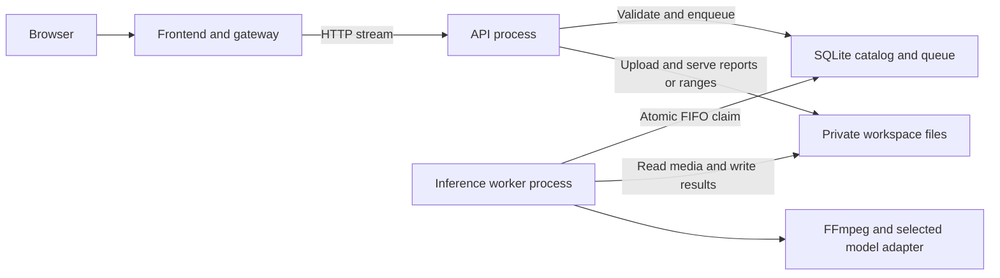

# Local service architecture

The restored interface is unchanged. Source separation is physical and runtime:
frontend code lives under `frontend/`, Python application/model code under
`backend/`, and inference executes outside the HTTP API process.

## Service boundaries

| Service | Responsibility | Entry point | Default listener |
| --- | --- | --- | --- |
| Frontend/gateway | HTML/CSS/JS, same-origin API forwarding, streaming uploads and playback | `speaker_frontend.server` | `127.0.0.1:8766` |
| Backend API | Validate requests; manage recordings, annotations, collections, reports and queued jobs | `speaker_id.workbench.server` | `127.0.0.1:8767` standalone; private free port under the launcher |
| Inference worker | Claim one job, extract audio, load selected models, persist progress and results | `speaker_id.workbench.worker` | None; durable local queue |

The one-command launcher runs the frontend in its supervisor process and starts
API/worker child processes. A native worker failure leaves frontend and API alive.
If the API stops, the frontend still serves assets and returns a backend-unavailable
error for API requests. The launcher reports service exits; it does not silently
restart failed inference. Ctrl+C or normal termination cleans up its children.
A forced SIGKILL of the supervisor is outside that graceful cleanup guarantee.



## Run everything locally

From the repository root, the existing command remains valid:

```bash
.venv/bin/python tools/run_workbench.py
```

Use the server terminal where `HF_TOKEN` is configured. The launcher passes the
shell environment to the worker and removes `HF_TOKEN` from the API subprocess.
The frontend/supervisor starts in that shell environment too; browser requests
never transmit the model credential. The API reads only the worker's credential-
presence boolean for readiness. No new credential storage is introduced.

The browser stays on port 8766; API port zero chooses a free private localhost
port. To select ports or a private workspace:

```bash
.venv/bin/python tools/run_workbench.py --port 8766 --api-port 8767 --data-dir data/workbench
```

The existing safe port-replacement behavior applies to the browser-facing
launcher. `--no-restart` opts out. An unrelated listener is never killed.
The exclusive worker lease also prevents two launchers on different ports from
running workers against the same data directory. Use a distinct data directory
for an isolated second instance.

The root package remains a compatibility/convenience distribution containing both
source packages. `pip install -e '.[audio,dev]'` and `voice-workbench` still work.
The root launcher also supplies source paths to child processes for checkout use.

## Run services independently

Choose either the root convenience install or standalone service installs in an
appropriate virtual environment. Avoid mixing editable install styles in the same
environment when evaluating packaging boundaries.

```bash
python -m pip install -e './backend[audio,dev]' -e ./frontend
```

Then use three terminals from the repository root, all referring to the same
absolute data directory:

```bash
# Terminal 1: API, no model credential needed here
python -m speaker_id.workbench.server --port 8767 --data-dir /absolute/path/to/data/workbench

# Terminal 2: worker; set HF_TOKEN only in this terminal
python -m speaker_id.workbench.worker --data-dir /absolute/path/to/data/workbench

# Terminal 3: frontend, no model credential needed here
python -m speaker_frontend.server --port 8766 --api-url http://127.0.0.1:8767
```

Standalone console entries are `voice-api`, `voice-worker` and `voice-frontend`.
`--embedded-worker` on the API is an explicit development/test fallback; it is not
the default service architecture. The frontend package has no ML or Node runtime
dependencies. Its small Python host avoids a frontend framework migration while
preserving the chosen plain-JavaScript UI.

## Persistence, claims and recovery

The shared private workspace stays at `data/workbench/` by default. Existing
recordings, voiceprints and reports need no copying or path migration.
SQLite WAL backs the catalog and job queue. `BEGIN IMMEDIATE` serializes the
oldest queued job's claim, and `claimed_by` records the worker instance. The API
is the only supported submitter service; one API and one worker per workspace
are supported. The worker holds an OS advisory lock before recovering jobs, so a
second worker cannot mark live inference interrupted. This implementation targets
macOS/Linux and a local disk, not network filesystems or multiple machines.

- API restart: active inference and pending jobs remain intact.
- Worker restart: previously running work becomes `interrupted`; queued jobs remain
  queued and are processed in order. Interrupted work requires an explicit new run.
- Worker crash: API uploads/playback continue. New analysis is rejected once the
  worker's status stops or heartbeat becomes stale (ten seconds). A hard crash's
  active job remains recorded as running until worker recovery; stale heartbeat
  alone cannot establish that a native operation stopped. Restart services to recover.
- Graceful launcher shutdown: children receive termination; after a bounded grace
  period, remaining children are killed. In-progress inference cannot resume.
- Queue capacity remains four active/queued jobs. No cancellation, retry of partial
  inference, exactly-once external side effects or multi-worker scaling is claimed.

The worker sends a heartbeat every two seconds independently of model counters.
`GET /api/health` reports API/worker availability; `GET /healthz` on the frontend
reports frontend availability. API state includes the worker PID, source revision,
heartbeat time and readiness without credential values. Source mismatch blocks new
runs; package/model changes require restarting the services.

## Network and data contract

All listeners remain on localhost. The gateway's upstream is restricted to a
localhost HTTP origin; it cannot be an arbitrary URL. It validates incoming Host
and Origin, then rewrites the origin for the internal hop. Existing API write-token
checks remain authoritative. Uploads and responses stream in one-MiB blocks;
Content-Length, Range, HEAD and Content-Disposition survive the hop. The gateway
never opens the private data directory and serves only its allowlisted assets.
The API serves no frontend files.

This is single-host service-oriented architecture with a shared store, not a
fully distributed microservice deployment. The useful split isolates ML failure
and dependencies while keeping local operations manageable. To deploy across
hosts, replace the local queue with a broker, move media to controlled object
storage, define versioned job/result contracts and add authenticated service
access, resource limits, cancellation and observability. Do that against measured
workload needs rather than adding infrastructure only for its name.

## Verification

86 Python tests and seven frontend tests pass locally. New integration coverage
includes multi-block uploads, byte ranges and HEAD through the gateway, origin/
token checks, frontend availability without the API, three distinct service PIDs,
worker exit without taking down the frontend/API, child cleanup on replacement,
concurrent atomic claims, duplicate-worker leases, API restart without job mutation,
and real worker-process crash/restart with synthetic inference.

Backend and frontend wheels build independently. ML calls in service tests use
stubs; no company media or real credentials are needed. Actual speaker accuracy,
multi-host operation and deployment readiness are separate evaluation tasks.
