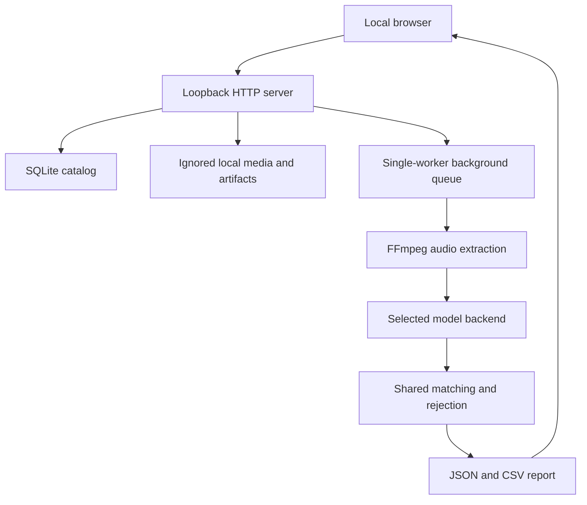

# Local workbench

## Implemented experience

The application has four views: Sessions, Reference room, Voice bank and
Run history. Opening a recording displays the original media, processing settings,
speaker tracks and an editable chronological review log. Reference recordings additionally expose clip
marking and quality controls. Profiles are reusable and specific to a model recipe.

The browser uses plain HTML/CSS/JavaScript and an HTML media element with an
accessible custom transport. The editor exposes playback, ten-second jumps,
scrubbing, speed and video fullscreen. Model/profile settings open in a dialog
from Analyze speakers (or Build voice profiles for references). Speaker tracks sit beneath playback, alongside the review
log on wide screens; narrow screens stack the panels. No external
fonts, CDN scripts, analytics, cloud storage or frontend build tool are required.
The Python package includes the static assets and a `voice-workbench` entry point.

## Request and data flow

`server.py` streams uploads to disk in blocks rather than loading an hour-long
file into memory. IDs determine disk paths; original file names are display
metadata. Byte-range and HEAD responses support browser seeking without full-file
transfer. The current upload ceiling is 4 GiB.

`store.py` uses SQLite records for media, collections and jobs. Operations open
separate connections; annotations and corrections use revision checks to reject
stale writes from another tab. Reference annotations also have a JSON export.

`service.py` validates job settings and profile/model compatibility before queueing.
An enrollment job snapshots the saved clean labels, extracts temporary WAV clips,
builds model-compatible centroids and persists an NPZ plus JSON metadata. It does
not update model weights. An identification job either reuses the shared named
identification pipeline or assigns anonymous names by first cluster appearance.

Jobs survive in the catalog, but in-flight execution does not survive a process
restart. Previously queued/running jobs are marked interrupted, without silently
re-running expensive inference. A single worker prevents concurrent models from
competing for laptop resources. Queue capacity is four jobs. Per-reference clip
extraction has a timeout; full inference has no hard timeout or cancellation yet.

## Local API

| Method | Route | Purpose |
| --- | --- | --- |
| GET | `/api/state` | Catalog, models, readiness and session write token |
| POST | `/api/upload?name=...&role=meeting` | Raw streamed file upload; role may be reference |
| GET / HEAD | `/api/media/<id>` | Original file with byte-range support |
| POST | `/api/media/<id>/duration` | Browser-detected duration when server probe is unavailable |
| POST | `/api/media/<id>/annotations` | Save reference labels with revision |
| GET | `/api/labels/<id>` | Download saved reference-label JSON |
| POST | `/api/jobs` | Queue enrollment or identification |
| GET | `/api/report/<job-id>` | Completed timeline |
| POST | `/api/report/<job-id>` | Save per-segment speaker corrections with revision |
| GET | `/api/export/<job-id>/json` | Download reviewed JSON |
| GET | `/api/export/<job-id>/csv` | Download reviewed CSV |

Writes require the `X-Workbench-Token` returned by the state endpoint. Host/origin
checks, no CORS permissions and a content security policy constrain browser access.
This is protection for a local application, not multi-user authentication. Do not
bind the server publicly or place it behind an internet-facing proxy as-is.

## Review semantics

The report retains cluster IDs and raw match scores. Editing a label adds the
original prediction and a reviewed flag; the first edit also preserves a complete
`.original.json` report. Corrections do not retrain models or silently change
reference profiles. CSV exports show the current reviewed labels; JSON includes
the richer provenance and review fields.

Speaker tracks preserve overlaps. Speaker-second totals can exceed recording
duration. UNKNOWN means identity was not accepted, including cases with no usable
clean identity speech. An anonymous label is not an enrolled identity across files.

The player follows the original audio/video. The backend extracts WAV directly
rather than introducing a lossy MP3 conversion. Browser codec support and model
format support are distinct.

## Verification

Local tests exercise uploads, content ranges including suffix ranges, HEAD,
foreign-origin rejection, stale-label conflicts, persisted annotations, synthetic
profile generation and reuse, backend compatibility, overlapping reports, manual
corrections and interrupted-job recovery. The current local suite passes 75 Python
tests and 19 frontend tests. JavaScript syntax is also checked with Node.
JSON and CSV exports use atomic file replacement, so readers never see a partial
individual export; the two formats are not one multi-file transaction.

Browser checks use an isolated temporary workspace with generated tone audio and
explicit synthetic timeline fixtures. They test presentation, media seeking and
speaker synchronization, not speech recognition quality. No synthetic data is
inserted into the user's normal library.

Real model inference on a conference recording remains unverified. Community-1
dependencies and packaged FFmpeg are installed locally, and cached Community-1
weights completed inference and emitted progress hooks on a synthetic tone.
ECAPA with actual weights and speaker accuracy remain unverified. Initial model
access requires the relevant Hugging Face conditions and a configured read token. Training, word transcription, Gemini
integration, full evaluation and public deployment remain future work.

## Interface decisions

The archive and the editor serve different tasks. The archive uses a compact
indexed list and a separate import area; the editor gives most of its space to
playback and temporal review. A persistent navigation sidebar no longer consumes
horizontal editing space. Configuration is available on demand rather than
competing with the player and speaker log.

The visual language uses paper, graphite, a restrained red navigation accent and
pastel voice markers. Colors identify voices consistently within a run; they are
not confidence indicators. The audio canvas uses an illustrative record graphic,
not a fabricated waveform. Timecode, seeking and speaker tracks reflect actual
media state and results. Controls respect reduced-motion preferences.

The redesigned editor was checked in Safari using isolated synthetic media:
selecting a log timestamp started playback at the corresponding segment and
showed the simultaneous labels. The model settings dialog was also inspected.
Chrome's native preview surface failed to render during this check; no Chrome
visual verification is claimed for the redesign. The existing 45 backend and HTTP
tests passed, JavaScript syntax passed Node checking, and static element bindings
were checked. These checks do not replace evaluation on real model outputs.

## Port reuse

The launcher first tries to bind its requested port. If it is occupied, it uses
lsof and ps to identify listeners and recognizes only this project's launcher,
the speaker_id.workbench.server module, or the installed voice-workbench entry
point. It rechecks process identity before each signal, sends SIGTERM, waits up
to three seconds, and escalates to SIGKILL only for the same recognized process.
An unrelated or unidentifiable listener is not terminated. `--no-restart` disables
this behavior; `--port` can select a different port. This implementation targets
macOS/Linux with lsof available.

The server binds before opening the workspace catalog, so an unsuccessful launch
cannot mark another running instance's jobs interrupted. The replacement instance
performs normal restart recovery after the old process has exited. Restart aborts
active processing; it does not resume model inference. Live tests launch two
isolated subprocesses on a temporary port to verify replacement and the opt-out.

## Analysis readiness and visible errors

The state endpoint reports availability of system or packaged FFmpeg, the required
audio packages, optional ECAPA and presence of HF_TOKEN. Preflight evaluates all
blockers for the chosen model rather than returning only the first one. A rejected
analysis request returns HTTP 409 with code setup_required and an issues list;
no job is queued. The frontend preserves that payload and displays it in a focused
alert inside the open run dialog. General page errors use the page-level alert.

The audio extra now installs imageio-ffmpeg as a fallback for systems where
Homebrew cannot install FFmpeg. The binary resolver is shared by conversion and
readiness checks. The optional ffprobe probe still requires a system ffprobe;
when absent, browser metadata supplies playback duration.

Validation for this change: 53 Python tests and three Node UI regressions pass.
The UI tests execute the actual app script in a minimal DOM fixture and simulate
a rejected Analyze request, checking alert visibility and focus inside the dialog.
Real packaged FFmpeg conversion and imports of torch, torchaudio, pyannote.audio
and TorchCodec were checked in the project environment. The initial model download
and actual speaker inference remain blocked until Hugging Face access is configured.

## Bounded analysis runs

Identification requests optionally accept start_seconds (default zero) and
duration_seconds (default null, meaning no duration limit). The job snapshots
these settings before queueing. Start must be nonnegative and duration, when
provided, strictly positive and finite. A known recording duration also rejects
starts at or beyond the source end. Enrollment continues to use the saved
reference clips; the range selector applies only to meeting analysis.

FFmpeg uses input seeking and a duration limit to extract a temporary WAV for
only the selected section. Both the shared named-identification pipeline and
anonymous path use these extraction options. For partial runs the decoded WAV's
frame count supplies the actual analysis duration, including clips shorter than
requested at the source end. Output speaker turns are clamped to that duration
and offset by the selected start. JSON includes analysis_range with original
start/end, actual duration, requested duration and a full-recording flag.

The editor keeps the original media and full-length timeline, displays a preview
scope notice, and distinguishes ranges in run history. Regions outside a partial
run have no predictions. Anonymous speaker numbering restarts by first appearance
in each analyzed section; it is not identity continuity across excerpts.

Validation: 66 Python tests and five Node UI tests pass. Coverage includes invalid
ranges, precise FFmpeg seek/duration arguments, real bounded audio extraction,
named/anonymous original-time offsets, overlapping turns, actual end-of-file
bounds, presets and playhead selection. Model accuracy on partial recordings is
not established by these tests.

## TorchCodec failure and direct waveform input

A real user run failed with `Could not load libtorchcodec`. Importing the audio
packages had passed earlier, but TorchCodec can defer native-library loading until
it actually decodes a file. A standalone packaged FFmpeg executable is sufficient
for our conversion subprocess; it does not provide TorchCodec's shared FFmpeg ABI.

The pyannote adapter now reads our mono 16 kHz WAV with SoundFile and passes a
`{"waveform": channel-first float32 tensor, "sample_rate": 16000}` dictionary to
the pipeline. Both meeting diarization and native enrollment use this path.
File-path decoding is no longer used by the adapter. This is pyannote's supported
in-memory input interface, not a framework monkey-patch or a change to model weights.

Validation: cached Community-1 weights loaded offline and completed actual CPU
inference on a three-second synthetic tone, returning zero turns as expected for
non-speech. This verifies the execution path, not identification accuracy. All
71 Python tests and five UI tests passed; new tests assert waveform use in both
native paths and validate the input shape/rate. Failed jobs now record their last
processing stage and elapsed time. A previously failed job stays failed; users
restart the updated server and submit a new run to retry.

## Detecting an outdated worker

State responses include a server protocol, PID, start time and the Python-source
fingerprint recorded at startup. When the current Python files differ from that
fingerprint, restart_required becomes true and job submission is rejected before
queueing. The UI also treats a worker without the protocol marker as outdated,
which protects users with a pre-upgrade process still serving freshly edited static
assets. A persistent banner and an in-dialog error explain the restart requirement.

The fingerprint excludes static assets: browser refresh is sufficient for UI-only
changes. An already running job is not cancelled by source detection. Restarting
is still an explicit terminal action and preserves the environment of the terminal
used to launch it; the UI never reads or transfers the Hugging Face token.

## Primary workflow recovery (milestone 2)

Analyze speakers is the visible entry point from a meeting. Explicit radio choices
separate anonymous clustering from saved-profile identification. New recordings
default to a five-minute section; the summary combines source, task, range, model
and voices. Expert matching/count settings remain secondary. Known setup blockers
appear on the work surface and near the sticky submit action. Local readiness
checks dependency/token presence, not remote model authorization or accuracy.

Draft settings are scoped by recording ID in browser sessionStorage, with an
in-memory fallback. They survive refresh in that tab; closing the tab clears the
draft. Tokens and media bytes are never put in drafts. Retry explicitly restores
the failed run snapshot. Model changes preserve identity mode and require a
compatible collection rather than silently falling back to anonymous analysis.

Latest job state and the displayed saved report are separate. Reviewing an older
result does not hide a new failure, and corrections target the displayed report ID
even while another run is active. Bounded runs show decoded scope, including the
case where a short recording fits completely inside the selected section.
Refresh fetches current state, and returning to a visible tab requests a refresh.

Developer browser checks used isolated synthetic recordings and a stub backend
through the regular job path: keyboard submission, saved result review, controlled
failure and retry settings were exercised. Increased-zoom inspection exposed
space pressure; the submit action stays visible and its repeated footnote is
omitted on short viewports. This is not a full mobile or screen-reader audit.
Safari's native picker did not enable the temporary WAV fixture, so browser upload
completion remains unverified in this pass; HTTP upload tests pass. A first-time
user review and device/browser accessibility checks remain open in the roadmap.
