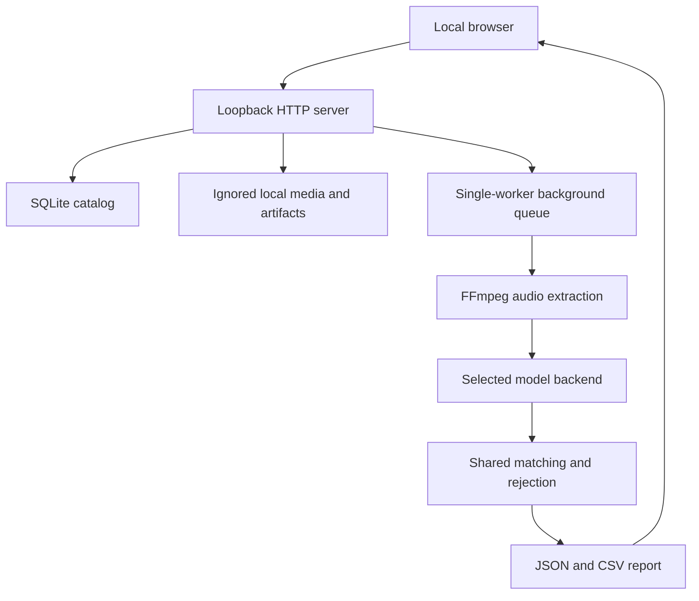

# Local workbench

## Implemented experience

The application has four views: Sessions, Reference room, Voice bank and
Run history. Opening a recording displays the original media, processing settings,
speaker tracks and an editable chronological review log. Reference recordings additionally expose clip
marking and quality controls. Profiles are reusable and specific to a model recipe.

The browser uses plain HTML/CSS/JavaScript and an HTML media element with an
accessible custom transport. The editor exposes playback, ten-second jumps,
scrubbing, speed and video fullscreen. Model/profile settings open in a dialog
from Configure run. Speaker tracks sit beneath playback, alongside the review
log on wide screens; narrow screens stack the panels. No external
fonts, CDN scripts, analytics, cloud storage or frontend build tool are required.
The Python package includes the static assets and a `voice-workbench` entry point.

## Request and data flow

`server.py` streams uploads to disk in blocks rather than loading an hour-long
file into memory. IDs determine disk paths; original file names are display
metadata. Byte-range and HEAD responses support browser seeking without full-file
transfer. The current upload ceiling is 4 GiB.

`store.py` uses SQLite records for media, collections and jobs. Operations open
separate connections; annotations and corrections use revision checks to reject
stale writes from another tab. Reference annotations also have a JSON export.

`service.py` validates job settings and profile/model compatibility before queueing.
An enrollment job snapshots the saved clean labels, extracts temporary WAV clips,
builds model-compatible centroids and persists an NPZ plus JSON metadata. It does
not update model weights. An identification job either reuses the shared named
identification pipeline or assigns anonymous names by first cluster appearance.

Jobs survive in the catalog, but in-flight execution does not survive a process
restart. Previously queued/running jobs are marked interrupted, without silently
re-running expensive inference. A single worker prevents concurrent models from
competing for laptop resources. Queue capacity is four jobs. Per-reference clip
extraction has a timeout; full inference has no hard timeout or cancellation yet.

## Local API

| Method | Route | Purpose |
| --- | --- | --- |
| GET | `/api/state` | Catalog, models, readiness and session write token |
| POST | `/api/upload?name=...&role=meeting` | Raw streamed file upload; role may be reference |
| GET / HEAD | `/api/media/<id>` | Original file with byte-range support |
| POST | `/api/media/<id>/duration` | Browser-detected duration when server probe is unavailable |
| POST | `/api/media/<id>/annotations` | Save reference labels with revision |
| GET | `/api/labels/<id>` | Download saved reference-label JSON |
| POST | `/api/jobs` | Queue enrollment or identification |
| GET | `/api/report/<job-id>` | Completed timeline |
| POST | `/api/report/<job-id>` | Save per-segment speaker corrections with revision |
| GET | `/api/export/<job-id>/json` | Download reviewed JSON |
| GET | `/api/export/<job-id>/csv` | Download reviewed CSV |

Writes require the `X-Workbench-Token` returned by the state endpoint. Host/origin
checks, no CORS permissions and a content security policy constrain browser access.
This is protection for a local application, not multi-user authentication. Do not
bind the server publicly or place it behind an internet-facing proxy as-is.

## Review semantics

The report retains cluster IDs and raw match scores. Editing a label adds the
original prediction and a reviewed flag; the first edit also preserves a complete
`.original.json` report. Corrections do not retrain models or silently change
reference profiles. CSV exports show the current reviewed labels; JSON includes
the richer provenance and review fields.

Speaker tracks preserve overlaps. Speaker-second totals can exceed recording
duration. UNKNOWN means identity was not accepted, including cases with no usable
clean identity speech. An anonymous label is not an enrolled identity across files.

The player follows the original audio/video. The backend extracts WAV directly
rather than introducing a lossy MP3 conversion. Browser codec support and model
format support are distinct.

## Verification

Local tests exercise uploads, content ranges including suffix ranges, HEAD,
foreign-origin rejection, stale-label conflicts, persisted annotations, synthetic
profile generation and reuse, backend compatibility, overlapping reports, manual
corrections and interrupted-job recovery. The final local suite passes 45 tests. JavaScript syntax is checked with Node.
JSON and CSV exports use atomic file replacement, so readers never see a partial
individual export; the two formats are not one multi-file transaction.

Browser checks use an isolated temporary workspace with generated tone audio and
explicit synthetic timeline fixtures. They test presentation, media seeking and
speaker synchronization, not speech recognition quality. No synthetic data is
inserted into the user's normal library.

Real model inference on a conference recording remains unverified. FFmpeg and the
optional ML dependencies are not installed in the inspected environment; model
weights require Hugging Face access. Training, word transcription, Gemini
integration, full evaluation and public deployment remain future work.

## Interface decisions

The archive and the editor serve different tasks. The archive uses a compact
indexed list and a separate import area; the editor gives most of its space to
playback and temporal review. A persistent navigation sidebar no longer consumes
horizontal editing space. Configuration is available on demand rather than
competing with the player and speaker log.

The visual language uses paper, graphite, a restrained red navigation accent and
pastel voice markers. Colors identify voices consistently within a run; they are
not confidence indicators. The audio canvas uses an illustrative record graphic,
not a fabricated waveform. Timecode, seeking and speaker tracks reflect actual
media state and results. Controls respect reduced-motion preferences.

The redesigned editor was checked in Safari using isolated synthetic media:
selecting a log timestamp started playback at the corresponding segment and
showed the simultaneous labels. The model settings dialog was also inspected.
Chrome's native preview surface failed to render during this check; no Chrome
visual verification is claimed for the redesign. The existing 45 backend and HTTP
tests passed, JavaScript syntax passed Node checking, and static element bindings
were checked. These checks do not replace evaluation on real model outputs.
